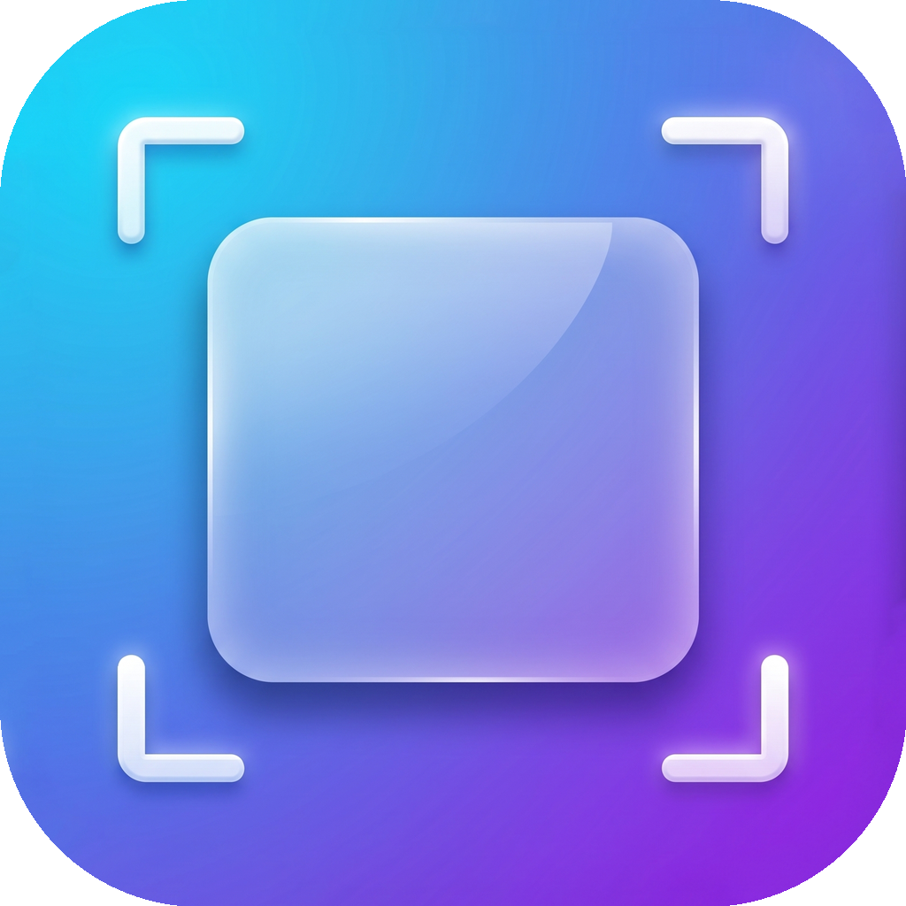
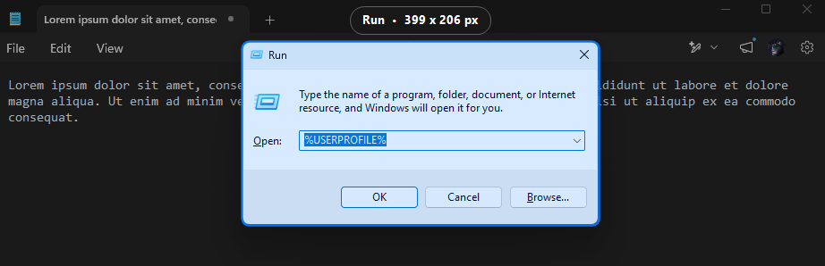
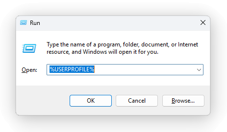

<p align="center">
  
</p>

<h1 align="center">ShadowSnap</h1>

<p align="center">
  <b>Instant macOS-style window screenshots with authentic Windows DWM drop shadows and pixel-perfect transparency.</b>
</p>

<p align="center">
  
  
  
</p>

---

## Overview

**ShadowSnap** is a lightweight, background utility for Windows 10 and Windows 11 that brings Apple macOS-grade window capture to Windows. It captures open windows or custom dialog regions with their genuine Desktop Window Manager (DWM) soft drop shadows, smooth corner rounding, and transparent paddings.

Captured images are copied directly to your clipboard in dual formats (PNG alpha stream and DIBV5) so they paste seamlessly into Telegram, Slack, Discord, Photoshop, Word, or web browsers without ugly black rectangular backgrounds.

<p align="center">
  
</p>

<p align="center">
  
</p>

---

## Key Features

- **Global Hotkey Activation**: Runs silently in the system tray. Press `Ctrl + Shift + A` anytime to trigger instant capture.
- **Interactive Window Detection**: Move your cursor over any desktop window to highlight it with a macOS-style rounded accent border and a floating pill badge displaying the window title and exact pixel dimensions (`W x H`).
- **Authentic DWM Drop Shadow Extraction**: Utilizes dual-pass background compositing and per-pixel alpha channel extraction to preserve genuine Windows DWM drop shadows and soft blurred edges.
- **Drag-to-Select Modals & Regions**: Click and drag to capture in-app dialogs, web modals, or arbitrary regions (e.g., in Chrome, Electron apps, Figma, or VS Code). ShadowSnap automatically applies corner smoothing and a soft dual-layer drop shadow.
- **Native Windows Toast Notifications**: Displays a Windows 10/11 Snipping Tool-style toast notification with hero image preview, clipboard confirmation, and direct markup integration.
- **Multi-Format Transparent Clipboard**: Simultaneously sets PNG alpha stream and DIBV5 formats on the Windows Clipboard, preventing black borders when pasting into any modern messaging or design app.
- **Automatic Storage**: Saves captures to `Pictures/Screenshots` with clean timestamped filenames.
- **Shutter Sound Feedback**: Plays a camera shutter sound upon successful capture.
- **Zero Heavy Runtimes**: Pure C# WinForms / Native Win32 desktop application with minimal memory footprint.

---

## Controls in Capture Mode

| Action | Control |
| --- | --- |
| Capture Highlighted Window | Left Click or `Space` / `Enter` |
| Select Custom Dialog / Area | Left Click + Drag |
| Cancel Capture Mode | Right Click or `Esc` |

---

## System Tray Menu

Right-click the ShadowSnap icon in the system tray to access:

- **Capture Window (`Ctrl + Shift + A`)**
- **Auto-save to Pictures/Screenshots** (toggle)
- **Play Camera Shutter Sound** (toggle)
- **Open Screenshots Folder**
- **Exit**

---

## Installation and Quick Start

### Quick Start
1. Run `start.bat` or launch `app/ShadowSnap.exe`.
2. Press `Ctrl + Shift + A` to capture your first window.

### Start with Windows Boot
To have ShadowSnap launch automatically on system startup:
- Run `powershell -ExecutionPolicy Bypass -File create_shortcuts.ps1` to create shortcuts on both your Desktop and Windows Startup directory.
- Alternatively, copy a shortcut of `app/ShadowSnap.exe` into `shell:startup`.

---

## Technical Architecture

- **Window Enumeration & Filtering**: Leverages Win32 `EnumWindows`, `IsWindowVisible`, `DwmGetWindowAttribute` with `DWMWA_CLOAKED`, and `DWMWA_EXTENDED_FRAME_BOUNDS` to accurately locate true top-level application windows while ignoring tooltips, overlays, and system utilities.
- **DWM Drop Shadow Extraction**: Uses full-bleed desktop region capture and per-pixel alpha reconstruction across high-contrast background sampling to calculate authentic soft drop shadow transparency.
- **Multi-Format Clipboard Engine**: Implements custom Windows Clipboard streaming for `PNG` and `Format17` (`CF_DIBV5`), ensuring high-fidelity alpha transparency across all target applications.
- **AUMID Toast Integration**: Dynamically registers the `ShadowSnap` Application User Model ID in `HKCU\Software\Classes\AppUserModelId\ShadowSnap` so Windows Notification Center displays the native hero preview without requiring a packaged MSIX installation.

---

## Building from Source

Prerequisites: [.NET SDK 10](https://dotnet.microsoft.com/) (or .NET 8 / 9 with Windows Desktop SDK).

```bash
# Build release binaries
dotnet build ShadowSnap.csproj -c Release

# Publish self-contained or framework-dependent application
dotnet publish ShadowSnap.csproj -c Release -r win-x64 --self-contained false -o app
```

---

## License

Distributed under the MIT License. See `LICENSE` for details.
